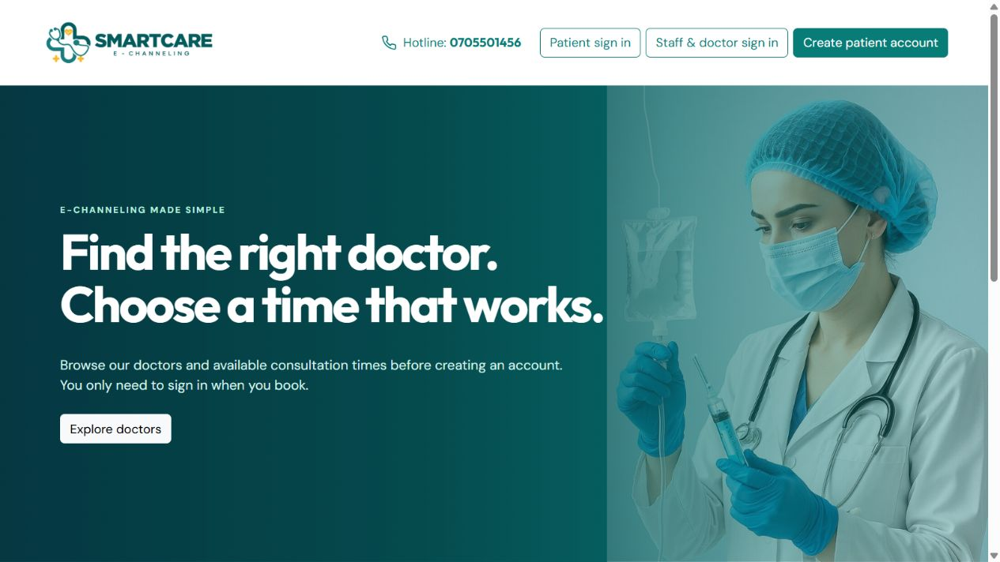

<div align="center">


<h1>SmartCare E-Channeling</h1>

<p><strong>Care begins with a better appointment.</strong></p>
<p>Find a doctor. Choose your time. Keep every visit organized.</p>

<p>
  
  
  
  
</p>

<p>
  <a href="#get-started">Get started</a> &nbsp;·&nbsp;
  <a href="#what-you-can-do">Features</a> &nbsp;·&nbsp;
  <a href="#gmail-password-reset">Email OTP</a> &nbsp;·&nbsp;
  <a href="#role-access">Roles</a> &nbsp;·&nbsp;
  <a href="#verification">Verification</a>
</p>

</div>

---



<p align="center"><em>A welcoming homepage, branch-based doctor browsing, and a hotline within reach.</em></p>

## What you can do

SmartCare brings appointment booking and clinic operations together in one Spring Boot application, with a React interface and a Microsoft SQL Server database.

| For patients and visitors | For the clinic team |
|---|---|
| 🩺 **Find the right doctor**<br>Browse branches, specialties, doctors, and open consultation times before signing in. | 🏥 **Manage care across branches**<br>Maintain doctor profiles, branch assignments, schedules, and leave. |
| 📅 **Book and manage visits**<br>Choose a time, manage future bookings, and review completed visits. | 🎟️ **Keep the queue moving**<br>Check in patients, call the next token, complete visits, and manage no-shows. |
| 🔐 **Recover account access**<br>Request a six-digit email OTP and set a new password. | 📊 **Understand daily operations**<br>Filter reports, preview templates, export PDF/Excel, and manage delivery schedules. |
| 🔔 **Stay informed**<br>Read booking updates, reminders, cancellations, and queue alerts. | 👥 **Work within your role**<br>Separate access for reception, doctors, managers, and administrators. |

**Need help?** The public homepage displays **Hotline: 0705501456**, with a tap-to-call link on supported devices.

## Get started

### Requirements

| Component | Used for |
|---|---|
| **Java 17 + Maven** | Spring Boot backend; the Maven wrapper is included. |
| **SQL Server / SQL Server Express** | Persistent application data and Flyway migrations. |
| **IntelliJ IDEA** | Opening the Maven project and running the included SmartCare configuration. |
| **Node.js + pnpm** | Editing and rebuilding React; the bundled frontend can run without Node. |
| **Gmail sender + App Password** | Sending password-reset OTP emails. |

### Run in IntelliJ IDEA on Windows

1. Install Java 17 and SQL Server Express. Enable TCP/IP for `SQLEXPRESS` and set a fixed TCP port of **1433**. Restart SQL Server after changing its network settings. This computer already has Java 17 and a reachable local SQL Server Express instance on port 1433.
2. Open PowerShell in this project folder and run `powershell -ExecutionPolicy Bypass -File scripts/setup-local.ps1`. It creates the `smartcare` database and `smartcare_app` login, then writes ignored credentials to `config/application-local.properties` outside the packaged app. You can pass `-AdminEmail your-address@example.com` on first setup. Re-running the script keeps the existing passwords.
3. Open this folder in IntelliJ IDEA as a Maven project. Select JDK 17. Let Maven import dependencies. Open the **SmartCare** run configuration and click Run. Alternatively, run the main class `lk.sunshine.smartcare.SmartCareApplication` with `SPRING_PROFILES_ACTIVE=local`.
4. Visit [http://localhost:8080](http://localhost:8080). Visitors see doctors with open times **today** first, followed by other doctors and future dates, without signing in. The count includes only unbooked times still in the future today. Booking prompts them to sign in or register as a patient. Flyway creates all 20 application tables at the first start. No patient, doctor, specialty, schedule, or appointment is automatically loaded. On first start only, the app creates one administrator account. Its email and password are in the ignored `config/application-local.properties` file under `smartcare.bootstrap-admin-*`. After staff sign-in, create reception, manager, administrator, and patient accounts from **Accounts**. Add hospital branches and specialties, then create each doctor with a unique login from **Doctors**. Doctors can edit their own profile, account details, password, schedules, and leave dates from **My schedule**. Other users use **My account**.

If SmartCare was already running in IntelliJ while the code changed, click **Stop**, then **Run SmartCare** again. Refreshing the browser alone does not reload Java permissions. Select the Java 17 SDK for the project and run configuration; this machine also has Java 24, which IntelliJ may choose by default.

Run `powershell -ExecutionPolicy Bypass -File scripts/check-db.ps1` to check the application's SQL login and all 20 tables.
After starting the app, run `powershell -ExecutionPolicy Bypass -File scripts/check-app.ps1` to verify the administrator login and database-backed screens.

<details>
<summary><strong>Local demonstration accounts and older verification scripts</strong></summary>

For this local workspace, `scripts/add-local-test-users.ps1` was run manually. It creates the first test doctor, reception, manager, and patient accounts, a specialty, and open slots; none of these are loaded automatically on startup. On a fresh database, run `scripts/local-test-password.ps1` first, then `scripts/add-local-test-users.ps1` while the app is running. Two further accounts and test appointments were added while checking separate doctor logins and the reception queue. Run the password script again whenever you need to reset these local accounts to the typed password `password`. Passwords are stored as BCrypt hashes in SQL Server. These are local demonstration records; use the current account settings if their details have changed.

| Role | Email | Password |
|---|---|---|
| Administrator | `kavid@localhost` | `password` |
| Doctor | `doctor@test.local` | `password` |
| Doctor 2 | `doctor2@test.local` | `password` |
| Reception | `reception@test.local` | `password` |
| Reception 2 | `reception2@test.local` | `password` |
| Manager | `manager@test.local` | `password` |
| Patient | `patient@test.local` | `password` |
| Patient 2 | `patient2@test.local` | `password` |

Run `scripts/check-role-flows.ps1` after `scripts/add-local-test-users.ps1` to verify visitor browsing, separate doctor logins, schedule ownership, assigned patient details, staff booking, and password changes. `scripts/check-queue-flow.ps1` verifies reception check-in, duplicate rejection, token order, call-next, and completion; it needs an available future time today and should be run before 22:00. `scripts/check-no-show-flow.ps1` verifies that only the assigned doctor can mark a called token no-show and checks the patient message and manager report. `scripts/check-fee-snapshot.ps1` temporarily changes and restores a doctor's fee to confirm existing appointments and receipts keep the original amount. `scripts/check-review-flow.ps1` checks one review per completed visit and patient ownership. `scripts/check-doctor-leave.ps1` checks calendar ownership, blocked times, and restoration after removing leave. `scripts/check-new-role-flows.ps1` checks separate sign-ins, branch and specialty management, admin patient creation, and doctor-owned appointment changes. `scripts/check-payment-admin-flow.ps1` checks that a booking appears in the admin panel before and after a simulated demo-card submission. These scripts create only explicit local test records.

</details>

### Rebuild the frontend

The compiled React frontend is already included in `src/main/resources/static`, so **Node is not needed to run the application**. To change React source, install Node.js and run:

```powershell
cd frontend
pnpm install
pnpm build
cd ..
```

`frontend/vite.config.js` writes the build into Spring Boot's static resources. Restart the Java app and refresh the browser after rebuilding.

The included Maven wrapper (`mvnw.cmd`) works without a separate Maven installation. From PowerShell, use `./mvnw.cmd test` for tests or `./mvnw.cmd spring-boot:run "-Dspring-boot.run.profiles=local"` to start outside IntelliJ.

---

## Homepage hotline

The public homepage displays a phone icon and **Hotline: 0705501456** beside the sign-in buttons. Visitors can use it without signing in. The number links to `tel:+94705501456`, allowing supported devices to open their calling application.

The hotline matches the existing teal design. On mobile, it appears below the logo and above the sign-in buttons. Desktop (1280px) and mobile (390px) layouts were checked without horizontal overflow, and the frontend build passed. See the [homepage screenshot](docs/screenshots/homepage-hotline.png).

To change the hotline, update the displayed number, accessible label, and `tel:` link in `frontend/src/features/PublicBrowse.jsx`. Its styling is in `frontend/src/public.css`. Rebuild the frontend, restart the Java application, and refresh the browser after making changes.

## Demonstration flow

**Browse → book → check in → call next → complete → review**

1. As a visitor, select a branch, browse its doctors and open times, then use patient sign-in or registration to finish booking.
2. As administrator, add branches and specialties, create a doctor with a separate login, then create reception, manager, and patient accounts from **Accounts**. Staff appear grouped by role.
3. As the doctor, edit your own profile, branch, email, password, schedule, and leave dates from **My schedule**. **Appointments** combines all your assigned visits with the live queue; only future confirmed visits can be rescheduled or cancelled.
4. As a patient, select Demo card or Pay at hospital while booking. Demo card opens a prefilled test-card screen; click **Submit payment** to record a simulated payment and see a receipt. The card fields stay in the browser and no money is charged. The admin panel immediately lists the appointment and updates its payment status. After a completed visit, the patient may leave one public review.
5. Reception opens directly in **Queue management**, showing each active branch and its assigned doctors, including doctors with no tokens. The date defaults to today in Sri Lanka; other dates are view-only. Search a patient ID, appointment ID, NIC, phone, or name to check in a confirmed appointment scheduled for today. Each doctor's card has **Call next** for that branch. Complete or mark the called patient **No-show**, then manually call the next patient. A doctor can have only one called patient across branches. Waiting visits can be **Deleted** (cancelled with history retained) or **Rescheduled** to an available future slot with the same doctor and branch. Rescheduling retires the old token and requires a fresh check-in. The board refreshes every 15 seconds. Managers monitor it read-only; doctors see and finish only their own called patients. Reports separate estimated booked/completed fees from **simulated** demo-payment figures.
6. Open **Alerts** as the patient or doctor. The bell in the dashboard header shows unread alerts and the latest messages; the full Alerts page filters booking confirmations, upcoming appointment reminders, schedule changes, cancellations, and queue updates. Patients can see the next scheduled reminder before it is due. For a new booking, the patient gets an alert 24 hours before the visit and another two hours before it; a booking made within 24 hours receives its first reminder immediately. Doctors receive updates for their own bookings and changes to their weekly schedule or leave. A cancelled or rescheduled appointment removes its outdated reminders. Reminders that have become overdue after the visit are discarded rather than sent on restart. Appointment alerts use the in-app inbox and optional local text previews; password-reset OTPs are sent separately by email.

For the local text-message demo, a patient can select **Create local text-file copies of my appointment alerts and reminders** during self-registration or in **My profile**, then save. The option is off by default, including for administrator-created patients. New booking confirmations, appointment reschedules, cancellations, and due 24-hour/two-hour reminders create separate files in `config/message-preview/` within about a minute. Open that folder in IntelliJ or File Explorer; each `notification-ID.txt` shows the phone number, appointment, event time, and message. The folder is ignored by Git and contains private details, so do not share it. Existing inbox history is not exported retroactively; pending reminders can create files when due. The in-app Alerts panel continues to work whether the option is on or off. This is a file simulation, not phone delivery.

In **Reports**, administrators and managers can generate several report cards at once: operations overview, doctor revenue by branch, total gross simulated revenue, and refund/cancellation rates. Filters include a date range of up to five years, branch, doctor, specialty/department, and payment method. Users can save owner-scoped reusable templates, edit or delete them, and create up to ten active daily, weekly, or monthly delivery schedules. Scheduled and saved-template exports are retained for seven days and can be downloaded or purged earlier. PDF and Excel remain available for immediate reports. External email/SMS delivery is represented by a replaceable simulated adapter until provider credentials are configured. See [report use cases](docs/report-use-cases.md) for the complete CRUD flow, validation rules, and formulas.

Patients can change their email, NIC, phone, and address in **My profile** at any time. NIC must be exactly 12 digits and phone numbers exactly 10 digits; the same rules apply when registering patients and adding emergency contacts. A changed email requires signing in again with the new address. Existing local test records with older placeholder NIC or phone values remain in SQL Server until edited.

The app uses Spring Security sessions rather than the JWT proposal. Login, permissions, and data checks run on the server. SQL migrations are in `src/main/resources/db/migration` and local credentials are never committed. The observer-style appointment event listener creates notifications; interchangeable report exporters implement a strategy pattern.

## Gmail password reset

The sign-in screen provides **Forgot password → enter registered email → request OTP → enter the six-digit OTP and a new password**. Codes expire after ten minutes, are stored only as hashes, allow five failed attempts, and can reset a password once. Each account can request up to five codes per rolling hour; requesting a new code invalidates the previous code. Responses do not reveal whether an account exists.

| Protection | Behavior |
|---|---|
| **Code privacy** | Only the OTP hash is stored in the database. |
| **Short lifetime** | Codes expire after ten minutes. |
| **Limited attempts** | The fifth failed verification invalidates the code. |
| **Request limit** | Up to five issued codes per account in a rolling hour. |
| **Single use** | A successful password reset consumes the code. |
| **Replacement safety** | Issuing a new code invalidates the previous one. |

For local Gmail delivery:

1. Enable [Google 2-Step Verification and create an App Password](https://support.google.com/accounts/answer/185833) for the Gmail sender account.
2. Run `powershell -ExecutionPolicy Bypass -File scripts/setup-gmail.ps1` from the project folder. Enter the sender address and App Password at the local prompts. The password prompt hides input. It saves credentials in ignored `config/application-local.properties`, preserving the database settings. Do not paste the App Password into chat or commit this file.
3. Restart the IntelliJ **SmartCare** configuration (which uses the `local` profile), refresh the browser, and request an OTP for an existing active account. Check the recipient's inbox and spam folder, then reset and sign in with the new password.

Gmail uses `smtp.gmail.com:587` with authentication, required STARTTLS, certificate hostname verification, and finite connection/read/write timeouts. For deployed environments, provide `MAIL_USERNAME` and `MAIL_PASSWORD` through the deployment's secret settings. `PASSWORD_RESET_FROM` defaults to the authenticated sender. Other SMTP providers can override `MAIL_HOST`, `MAIL_PORT`, and the existing mail settings.

Delivery failures never expose OTPs in responses or preview files. Console OTP logging is disabled by default, including local Gmail setup; it requires both a `dev`/`local` profile and explicitly setting `PASSWORD_RESET_LOG_CODE_ON_FAILURE=true`. Gmail credentials affect password-reset email only; appointment text previews and report delivery retain their existing behavior. Actual Gmail delivery requires valid sender credentials and network access.

## Role access

Administrators can deactivate patient accounts from **Accounts → Patients**, then permanently delete an inactive patient with no appointment history after confirming the email address. Reviews, notifications, audit records, and moderation history do not independently block patient deletion. Deletion removes the patient's reviews, notifications, password-reset tokens, and emergency contacts; audit records and other reviews' moderation history remain with the deleted account's actor references set to null. Appointment, payment, and queue history remains protected. Staff-account deletion retains its existing rules.

| Role | Allowed actions |
|---|---|
| Visitor | View branches, active doctors, specialties, and open times; use patient sign-in or registration before booking. |
| Patient | Edit only their own profile, account, password, and contacts; book, change, cancel, and choose demo payment for only their own future appointments; keep older appointments as read-only history; read only their own alerts; leave one review for each completed visit. |
| Doctor | See only their own profile, schedule, leave dates, assigned appointment history and basic patient details, queue, and alerts; reschedule or cancel only their own future confirmed visits; complete or mark only their own called tokens no-show; edit their profile and login details. |
| Reception | Open in the branch and doctor queue board; check in today's confirmed appointments; call, complete, or mark No-show; cancel or reschedule waiting visits; view queue history; search patients and book open slots; edit their own account. |
| Manager | Monitor queues and waiting times by date, read-only; filter, view, export, save, schedule, and manage owned operational reports; edit their own account and password. |
| Administrator | See every appointment, including future bookings, patient details, branch, fee, and payment status; create staff and patient accounts; manage branches, specialties, doctors, queues, and owned report templates/schedules. |

The React menu displays only relevant screens, and each API action also checks the role and record owner on the server. Doctor names and availability remain public to visitors, while a signed-in doctor's dashboard loads only their own profile and private work. Past appointment actions are hidden and the Java API rejects late changes even if called directly.

## Coursework deliverables

`docs/design.md` contains the corrected system flows, database outline, testing scenarios, and sprint plan. `docs/execution-plan.md` corrects the pasted plan to use localhost SQL Server and records the role and past-appointment rules. In particular, the design notes replace the queue activity page that incorrectly shows doctor management in the supplied PDF. Use real screenshots, contribution reflections from each member, and IEEE references in the week-10 design document and week-13 final report.

## Project map

```text
SmartCare
├── frontend/src/
│   ├── features/                  React screens organized by feature
│   ├── assets/                    Logos and homepage photography
│   └── public.css                 Public homepage and hotline styles
├── src/main/java/lk/sunshine/smartcare/
│   ├── features/                  Six main application feature areas
│   └── shared/                    Authentication and password-reset services
├── src/main/resources/
│   ├── db/migration/              Flyway schema migrations
│   └── static/                    Built frontend served by Spring Boot
├── src/test/                      Backend tests
├── scripts/                       Local setup and verification tools
├── config/                        Ignored local credentials and text previews
└── docs/                          Design notes, verification, and screenshots
```

## Verification

| Check | Run from the project folder |
|---|---|
| Backend tests | `./mvnw.cmd test` |
| Frontend build | `cd frontend`, then `pnpm build` |
| SQL login and schema | `powershell -ExecutionPolicy Bypass -File scripts/check-db.ps1` |
| Administrator login and screens | `powershell -ExecutionPolicy Bypass -File scripts/check-app.ps1` |
| Current application flows | `powershell -ExecutionPolicy Bypass -File scripts/check-current-flows.ps1` |
| Report regressions | `powershell -ExecutionPolicy Bypass -File scripts/check-report-regressions.ps1` |

Run the API verification scripts against a running local app. The current-flow script creates labelled QA records and deactivates its test patients, staff, doctor login/profile, and branch afterward; audit and appointment history remain. The report script covers grouping, exports, template preview, and UTC schedule checks. The older role-flow scripts in the expandable setup section predate these API changes.

SQL Server queue integration tests require their opt-in test database configuration. The Gmail connection check also requires explicit opt-in; it authenticates without sending an email. See the corresponding tests under `src/test/` before enabling these checks.

### Documentation library

| Document | Contents |
|---|---|
| [Design](docs/design.md) | System flows, database outline, scenarios, and sprint plan. |
| [Doctor viva notes](docs/doctor-viva-notes.md) | Doctor-module explanation, code guide, demonstration, and viva questions. |
| [Execution plan](docs/execution-plan.md) | Local setup decisions, ownership, and appointment rules. |
| [Report use cases](docs/report-use-cases.md) | Report operations, validation, and formulas. |
| [Verification record](docs/verification-2026-09-27.md) | Dated verification notes from September 27, 2026. |
| [Homepage preview](docs/screenshots/homepage-hotline.png) | Public homepage with the hotline. |

---

<div align="center">
<strong>SmartCare · Sunshine Healthcare Lanka</strong><br />
<sub>Simple booking. Clear queue updates. Private accounts.</sub>
</div>


