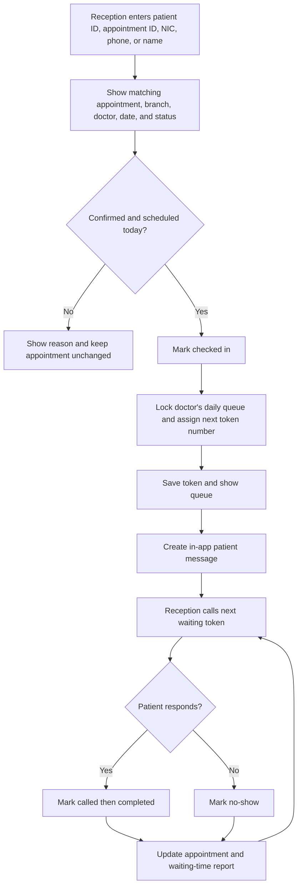
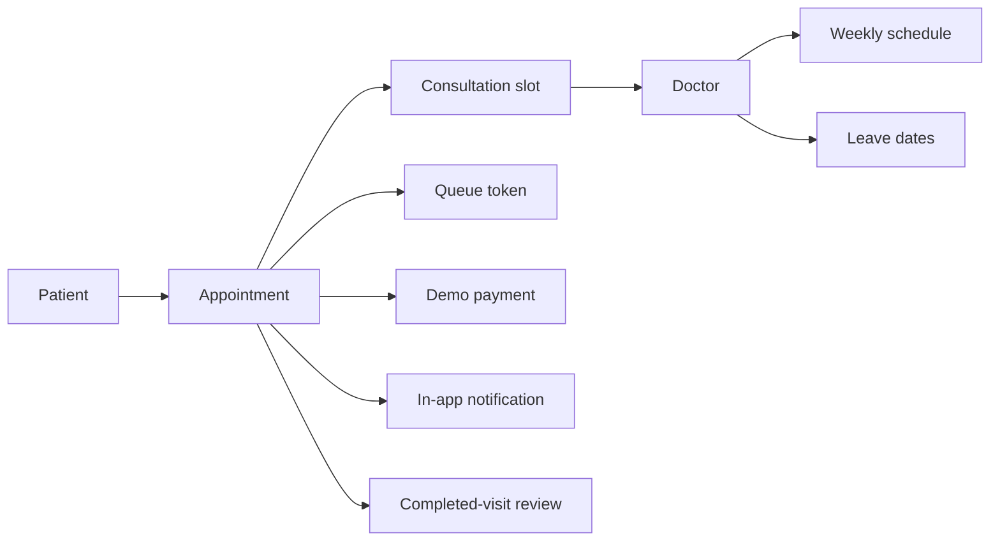

# SmartCare design and coursework notes

SmartCare is a single-hospital Java web app. Its React browser interface calls Spring Boot JSON endpoints; Spring Security keeps a server-side login session, and JDBC writes to Microsoft SQL Server. The supplied proposal suggested JWT and real gateways, but this assessed prototype uses simpler sessions, a demonstration-only payment record, and in-app notifications. It does not collect card details or send SMS/email.

The database starts without sample patients, doctors, specialties, appointments, or queue entries. It creates a Main Branch reference record so the first doctor and booking have a valid location. Local setup generates one initial administrator credential outside the packaged app. That administrator creates reception and manager accounts and creates each doctor account together with its linked profile. The administrator may also create other administrators. Every staff member has a separate login. Patients self-register or are registered by an administrator, and visitors may select a branch and browse active doctors and available slots before logging in. Booking requires a patient login.

## Six functions and actors

| Major function | Primary actors | Owner |
|---|---|---|
| Patient account and emergency contacts | Patient | Mallawa O.I, IT25101650 |
| Doctor profile, schedule, availability | Doctor, administrator | Dharmakeerthi S.D.K.P, IT25100724 |
| Booking, changes, demo payment | Patient | Meththananda K.H.R, IT25102611 |
| Check-in and queue tokens | Reception | Kolambage K.H.S.S, IT25103664 |
| Feedback, in-app messages, and reminders | Patient, administrator, doctor | Suriyaaarachchi S.I.D, IT25101777 |
| Operational reports | Manager, administrator | Adassuriya A.V, IT25103522 |

The report dashboard supports multiple generated cards: operations overview, doctor revenue by appointment branch, total gross simulated revenue, and refund/cancellation rates. Administrators and managers can filter by date, branch, doctor, specialty/department, and payment method; save owner-scoped reusable templates; maintain up to ten active delivery schedules; and export PDF or Excel files. Generated template and scheduled files expire after seven days. External delivery uses a replaceable simulated adapter until an email/SMS provider is configured. The complete CRUD flow, validation rules, and calculations are in [report use cases](report-use-cases.md).

## Feedback and notification management

Patients can create, view, edit, and soft-delete one active feedback entry for each completed appointment. Ratings are limited to 1–5, comments are optional, and administrators can list and moderate active feedback without editing patient content. Deleted feedback is excluded from public doctor ratings and may be replaced by the patient. Feedback remains a separate page from the notification inbox even though both responsibilities belong to this combined feature module.

When a patient or reception staff books a visit, the patient and assigned doctor receive an in-app booking confirmation with the visit date, doctor or patient name, branch, and appointment number. The patient receives appointment reminders 24 hours and two hours before the visit. If booked within 24 hours, the first reminder appears immediately; if booked within two hours, only one immediate reminder appears. The Alerts page displays the next scheduled reminder even before it arrives in the inbox. Rescheduling sends a schedule-change alert to both people and replaces the old reminders; cancellation alerts both and removes them. When a doctor or administrator changes that doctor's weekly schedule or leave, the doctor receives a separate schedule alert. Existing booked visits stay scheduled after a weekly schedule edit. Each signed-in patient or doctor sees only notifications addressed to their own account through the header bell and the filterable Alerts page, where unread items can be marked read. The alert list refreshes periodically and after local actions. Patients may opt in to local text-file copies of their own booking, reminder, reschedule, and cancellation alerts. The notification ID is the file name, so restarts do not duplicate files; older inbox history is not exported. No email or SMS is sent.

## Corrected activity flow: patient check-in and queue

The page titled “Process Patient Check-In & Token Tracking” in `B5G1_09_Activity.pdf` shows doctor profile and schedule management. Replace that page with the following flow when preparing the submitted design PDF:

Reception lands in the queue board with separate branches and assigned doctor cards. The selected date defaults to today in Asia/Colombo; other dates are read-only. Lookup returns today's confirmed appointments without active tokens. Check-in locks the doctor and appointment before assigning a unique doctor/day number. Each doctor card calls the next waiting token in its branch, with at most one called token for that doctor across branches. Completing or marking No-show does not advance automatically: reception clicks Call next afterward. Waiting visits may be cancelled, releasing the slot while retaining queue history, or moved to an available future slot with the same doctor and branch. Rescheduling retires the old token and returns the appointment to CONFIRMED for a fresh check-in. Stored branch and consultation-time snapshots preserve old queue records. Managers monitor read-only; doctors see and finish only their own called patients. The board polls every 15 seconds.

## Booking and database design

The database migrations create `app_user`, `patient`, `emergency_contact`, `specialty`, `doctor`, `schedule_template`, `doctor_leave`, `branch`, `slot`, `appointment`, `queue_token`, `demo_payment`, `notification`, `audit_event`, and `appointment_review`. Primary and foreign keys preserve relationships. Email and NIC are unique. A doctor has at most one slot at a given start time, and a doctor/day token number is unique. Booking claims a slot with one conditional SQL update inside a transaction; if another patient wins, the second request gets a conflict response. It also saves the doctor's fee on the appointment so later fee changes cannot rewrite history. Cancellation frees the slot but keeps the old appointment row for history. A called patient who does not respond can be marked `NO_SHOW` by reception or the assigned doctor. Only the patient who attended a completed appointment can leave its single review; ratings appear on the public doctor list. Doctors may block future leave dates only when no appointments are booked for that day.

## Design patterns and ethics

`AppointmentEvent` and `NotificationService` use an observer-style event listener after a booking transaction commits. `ReportExporter` has PDF and XLSX implementations selected by format, a strategy pattern. Neither pattern changes the simple controller/service/JDBC structure.

Passwords use BCrypt. Role checks and patient ownership checks run on the server. CSRF tokens protect state-changing requests. Audit rows record account, booking, doctor, queue, and demo-payment changes. The UI avoids showing one patient's records to another. Patient profile edits include email and NIC, with uniqueness checks, exact 12-digit NIC and 10-digit phone validation, and a fresh sign-in after an email change. The same digit rules apply to registration, admin patient creation, and emergency contacts. Payment is marked simulated everywhere, and the application never requests card data. Inputs are labelled, layouts adapt to small screens, and errors explain what the user can correct.

The public website shows active doctor profiles and open slots to visitors. A signed-in doctor dashboard loads only that doctor's own profile, weekly schedules, appointment history, and queue in one panel. The Java API checks `doctor.user_id` before any profile or schedule change, even if a request bypasses React. Editing or disabling a schedule retires its unbooked future slots while preserving existing reservations. A doctor sees basic patient details only for appointments assigned to that doctor, plus that doctor's queue entries and messages. Patient records and messages are similarly scoped to the logged-in patient. For past appointments, the patient and doctor see read-only history: reschedule, cancel, and demo-payment choices disappear, and the API rejects those changes. Reception searches appointments by patient ID, appointment ID, name, NIC, or phone; the result shows the branch and confirmed status before an eligible check-in. Managers see a read-only queue and filter operational reports by date and doctor. Administrators see all bookings and payment updates, including future visits, while managing staff and doctor accounts, queues, and reports. The booking form saves the selected payment method; a demo card remains pending until the patient clicks Submit on a prefilled test-card screen. The React menu hides controls outside each role's tasks; the Java API enforces the same boundaries. The full access table is in `README.md`.

## Sprint and test record template

| Week | Deliverable |
|---|---|
| 3–6 | Proposal, refined requirements, corrected use-case/activity/sequence diagrams, ER/class design |
| 7 | Maven/React foundation, login, SQL migration, shared UI |
| 8 | Patient and doctor features |
| 9 | Transactional appointments and queue |
| 10 | In-app notifications and basic reports; demonstrate approximately 75% completion |
| 11 | Demo payment, exports, integration fixes, automated tests |
| 12 | User acceptance rehearsal, accessibility and stability fixes, report screenshots |
| 13 | Final presentation, viva, individual reflections and final PDF report |

For the progress design document, include sprint summaries, final use-case diagram, class diagram, six correct activity diagrams, and ethical considerations. For the final report, add the ER diagram, real UI screenshots, measured test results, individual contribution and lessons-learned rows written by each member, and IEEE-formatted references. Do not claim 99.9% availability for a local classroom prototype.

Acceptance scenarios: visitor doctor/slot browsing and booking login gate; invalid registration; duplicate NIC/email; distinct doctor logins and rejected cross-doctor edits; own schedule edit and stale-slot retirement; own-account password change; assigned-only patient details; rejected unauthorized access; overlapping doctor schedules; two patients racing for one slot; reschedule/cancel history; duplicate check-in; daily token order; call/skip/complete; manager queue visibility; due reminder visibility; simulated revenue totals; PDF/XLSX export; and data retained after restart. `scripts/check-role-flows.ps1` and `scripts/check-queue-flow.ps1` exercise the main role and queue paths against SQL Server.
