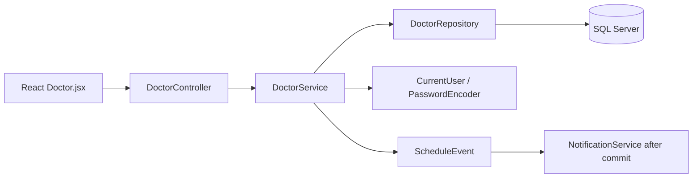

# Doctor Management — Final Viva Notes

**SmartCare E-Channeling · Prepared from the current project code on October 5, 2026**

This guide covers the doctor-management module and the shared features a signed-in doctor uses. Explain your actual contribution honestly: appointments, queues, notifications, authentication, and password recovery are integrated features with their own source files.

## 1. Your one-minute introduction

“My assigned part is doctor management in SmartCare E-Channeling. It manages doctor profiles, specialties, branch assignments, consultation dates, generated appointment slots, and leave dates. Each doctor has a separate login linked to their profile. Administrators can create and manage doctors, while a doctor can manage only their own profile and calendar.

“The interface uses React, the backend uses Spring Boot, and the database is Microsoft SQL Server. My backend follows a controller, service, and repository structure. The service validates business rules, such as preventing overlapping consultation dates and blocking leave when patients are already booked. The repository uses Spring JDBC to execute parameterized SQL.

“My module connects with appointment booking, reception queues, and notifications. Available slots allow patients to book, and a doctor can see their assigned appointments and complete their own called patients. The main objective is to keep doctor availability accurate and protect other doctors’ information.”

## 2. Learn these facts first

| Topic | Correct answer for this project |
|---|---|
| Frontend | React, especially `Doctor.jsx`. |
| Backend | Spring Boot with Java 17. |
| Database | Microsoft SQL Server. |
| Doctor data access | `JdbcTemplate` and explicit SQL, **not a JPA doctor entity/repository**. |
| Authentication | Spring Security sessions, **not JWT**. |
| Password storage | BCrypt hashes through `PasswordEncoder`. |
| Scheduling | **Specific consultation dates**, not automatically repeating weekly appointments. |
| Multiple branches | A `doctor_branch` association stores the room and fee for each doctor/branch pair. |
| Authorization | Backend role and ownership checks; hiding buttons is only a frontend convenience. |
| Queue handover | Reception/admin calls the next patient; the assigned doctor can complete or mark their own called patient no-show. |
| Notifications | In-app alerts; Gmail OTP is a separate shared password-reset feature. |

The existing module README previously referred to “recurring availability.” The current implementation uses `scheduleDate` and generates slots on that particular date. The historical table name `schedule_template` does not mean the current feature repeats automatically.

## 3. What belongs to your part

### Main doctor-management features

1. Display doctors and filter them by specialty and, on the public homepage, branch.
2. Create a doctor profile together with a separate login account.
3. Link a profile to an existing account whose role is `DOCTOR` through the backend.
4. View and update doctor profile information.
5. Assign one doctor to several hospital branches.
6. Maintain a branch-specific room and consultation fee.
7. Add, view, edit, and disable dated consultation schedules.
8. Generate bookable time slots from a schedule.
9. Record and remove current/future leave dates.
10. Reject duplicate medical IDs, duplicate emails, duplicate branch assignments, and invalid scheduling requests.
11. Record audit events and publish schedule-change events.
12. Allow an administrator to delete an unused doctor profile and its linked login, subject to dependency checks.

### Related features used by doctors

- **My profile & schedule:** the doctor-management screen.
- **Appointments:** assigned patient visits, future appointment changes, and an embedded live queue.
- **Alerts:** booking changes, schedule updates, and next-patient alerts.
- **Account controls:** shared account details and password-change UI.
- **Forgot password:** shared email OTP recovery used by eligible active accounts, including doctors.

Branch and specialty maintenance is included in the doctor-management area. Their current APIs support **listing, creation, and removal**. There is no separate branch-edit or specialty-edit endpoint in these controllers; do not describe those two features as complete CRUD.

## 4. Architecture and important files



| File | What to explain |
|---|---|
| [Doctor.jsx](../frontend/src/features/Doctor.jsx) | Forms, selections, state, API calls, and doctor/admin views. |
| [DoctorController.java](../src/main/java/lk/sunshine/smartcare/features/doctor/DoctorController.java) | HTTP routes, validated request records, and service calls. |
| [DoctorService.java](../src/main/java/lk/sunshine/smartcare/features/doctor/DoctorService.java) | Permissions, ownership, transactions, profile rules, scheduling, slots, and leave. |
| [DoctorRepository.java](../src/main/java/lk/sunshine/smartcare/features/doctor/DoctorRepository.java) | SQL reads/writes through `JdbcTemplate`. |
| [BranchController.java](../src/main/java/lk/sunshine/smartcare/features/doctor/BranchController.java) | Public branch listing and administrator-only branch creation/removal. It directly uses `JdbcTemplate`. |
| [SecurityConfig.java](../src/main/java/lk/sunshine/smartcare/shared/SecurityConfig.java) | Session login, BCrypt, CSRF protection, and public/private routes. |
| [CurrentUser.java](../src/main/java/lk/sunshine/smartcare/shared/CurrentUser.java) | Reads the active account’s ID/role and writes audit records. |
| [DoctorServiceTest.java](../src/test/java/lk/sunshine/smartcare/features/doctor/DoctorServiceTest.java) | Twelve existing unit tests covering important doctor rules. |

**Request journey:** React collects input → `api.send()` sends JSON with a CSRF token → controller validates the request → service checks permissions and rules → repository executes SQL → JSON response updates the screen.

The controller handles HTTP concerns. The service handles business decisions. The repository handles storage. This separation makes the code easier to test and change.

## 5. Database relationships

| Table | Purpose and important relationships |
|---|---|
| `app_user` | Login email, password hash, full name, role, and account-active status. |
| `doctor` | Medical profile, linked `user_id`, display name, unique medical registration ID, specialty, department, and profile-active status. |
| `specialty` | A specialty can be assigned to multiple doctors. |
| `branch` | A hospital location; an active branch can host multiple doctors. |
| `doctor_branch` | Links doctors and branches; stores `room`, `fee`, and assignment-active status. The doctor/branch pair is unique. |
| `schedule_template` | Doctor, branch, specific date, start/end time, slot duration, maximum patients, and active status. |
| `slot` | Actual start/end timestamps, doctor, branch, status, and retirement state. Doctor/start-time pairs are unique. |
| `doctor_leave` | Doctor, leave date, and optional reason. Doctor/leave-date pairs are unique. |
| `appointment` | A patient’s booking of a generated slot; connects this module to appointments. |
| `notification` / `audit_event` | In-app messages and recorded actions used by shared features. |

### Relationships to remember

- An account can have at most one linked doctor profile; new doctors created by the UI have their own linked account.
- One specialty has many doctors.
- Doctors and branches have a many-to-many relationship through `doctor_branch`.
- One doctor has many consultation schedules, slots, and leave records.
- A schedule describes the time window; slots are the individual times patients can book.

**Why separate account and profile?** Login credentials and permissions belong to `app_user`; professional and scheduling information belongs to the doctor-related tables. This avoids mixing authentication with medical-profile data.

**Why store fee and room in `doctor_branch`?** The same doctor may use different rooms and charge different fees at different branches.

**Why Flyway?** Migration files record schema changes in order. Relevant migrations include [V1 schema](../src/main/resources/db/migration/V1__schema.sql), [V8 leave](../src/main/resources/db/migration/V8__doctor_leave.sql), [V13 medical ID](../src/main/resources/db/migration/V13__doctor_registration_id.sql), and [V15 multiple branches](../src/main/resources/db/migration/V15__doctor_multi_branch.sql).

## 6. Doctor creation: explain it step by step

The main UI sends `POST /api/doctors/with-account`.

1. The administrator enters name, Gmail login email, initial password, medical registration ID, specialty, department, and branch assignments.
2. The controller applies request validation, including required fields, a minimum eight-character password, and nonnegative fees.
3. `createDoctorWithAccount()` requires the `ADMIN` role.
4. `EmailPolicy` normalizes and checks the new Gmail address. The service rejects an email already used by any account.
5. The medical registration ID is trimmed, converted to uppercase with `Locale.ROOT`, validated, and checked for duplicates.
6. Every branch must exist and be active. The same branch cannot appear twice in the request.
7. The password is encoded through `PasswordEncoder`; the raw password is not stored.
8. The repository inserts an `app_user` row with role `DOCTOR`, inserts the doctor profile, and saves the branch assignments.
9. Audit records identify the staff-account and profile creation.
10. All these database changes are in one transaction. A failure rolls back the operation rather than leaving a partially created doctor.

`OUTPUT INSERTED.id` returns the database-generated ID so that related rows can be linked correctly.

The alternate `POST /api/doctors` route creates a profile for an existing doctor account. It rejects a non-doctor account or an account already linked to another profile.

## 7. Profile editing and deletion

### Editing

The administrator uses `PUT /api/doctors/{id}`. A signed-in doctor uses `PUT /api/doctors/me`; the backend finds the profile from the authenticated account.

Editable information includes name, email, specialty, department, public-active status, branch assignments, room, and fee. The service updates the linked account name/email as well as the doctor profile.

The medical registration ID is **read-only after creation**. It is not part of `DoctorUpdateInput`, so the normal update route cannot change it simply by adding that field to JSON.

Changing an email requires an unused Gmail address. An unchanged legacy email is accepted. The doctor-profile UI logs the doctor out when the email changes so they can sign in again with the new address.

A branch with future booked slots cannot be removed from the doctor’s assignments. Removing an eligible assignment retires its future open slots and disables its schedules before removing the association.

### Deleting

Only an administrator can delete a doctor. `deleteDoctor()` first removes eligible inactive schedules and retired, unbooked slots without appointment references. It then checks remaining schedules, slots, and leave dependencies.

If dependencies remain, deletion is rejected. A used doctor can be made inactive on the public website instead of erasing appointment history. Profile-active status and login-account-active status are separate fields; making the profile inactive does not itself disable the login.

For an eligible deletion, branch assignments and the profile are removed, along with the linked doctor login. Existing audit actor references are anonymized and notifications are cleaned up. The operation is transactional and a delete audit record is added.

## 8. Scheduling and slot generation

### Inputs

| Input | Rule |
|---|---|
| `scheduleDate` | Required; today or a future date. |
| `startTime` / `endTime` | Required; end must be later than start. For today, the start must still be in the future. |
| `slotMinutes` | Between 5 and 120 minutes. |
| `capacity` | Between 1 and 100 patients. |
| `branchId` | Must be an active branch assigned to this doctor. |

The backend also rejects leave dates, overlapping schedules for the doctor, and conflicting schedules in the same named room at the selected branch.

### Slot-generation example

Suppose the schedule is **October 6, 2026, 09:00–12:00**, with **30-minute slots** and capacity **6**.

| Slot | Time |
|---|---|
| 1 | 09:00–09:30 |
| 2 | 09:30–10:00 |
| 3 | 10:00–10:30 |
| 4 | 10:30–11:00 |
| 5 | 11:00–11:30 |
| 6 | 11:30–12:00 |

For a clear future window without existing conflicts, the number of candidate slots is:

`min(capacity, floor(window duration / slot duration))`

A capacity of 4 produces only the first four candidate slots. A capacity of 10 still fits only six. A partial slot that extends past the end time is not created.

### Explain `generate()`

1. Start at the selected date and start time.
2. Continue while the capacity has not been reached and the full slot fits within the end time.
3. For each candidate still in the future, ask the repository to create or restore a slot.
4. Advance the candidate start by `slotMinutes`.

The repository avoids creating candidates that overlap a booked slot, restores eligible blocked slots, and avoids inserting a duplicate doctor/start-time pair. Actual available slots can therefore be fewer than the candidate count.

### Overlap rule

Two time windows overlap when:

`existingStart < newEnd AND existingEnd > newStart`

For example, 09:00–10:00 conflicts with 09:30–10:30. A new window starting exactly at 10:00 can follow 09:00–10:00 without overlap.

Doctor overlap is checked across branches, because the same doctor cannot attend two consultations at the same time. Room overlap checks other doctors at the same branch and date when a room is specified. A blank room has no room-conflict check.

### Editing or disabling a schedule

- Editing validates the replacement schedule, retires old future slots, updates the schedule, and generates replacement candidates.
- Disabling sets the schedule inactive and retires its future slots.
- Retired available slots become blocked; existing booked slots retain their booked status and booking history.
- Changing a schedule does **not** automatically reschedule existing patients. Those appointments must be handled through the appointment workflow.
- Each successful schedule change writes an audit record and publishes a `ScheduleEvent`.

## 9. Leave management

Adding leave uses `POST /api/doctors/{id}/leave`.

1. Require the owner doctor or an administrator.
2. Require today or a future date and reject a duplicate leave date.
3. Retire open slots for that date.
4. Check whether booked slots exist. If they do, reject the leave request; the transaction rolls back the earlier slot changes.
5. Otherwise, insert the leave record, audit the action, and publish a schedule-change alert.

**Reason:** patients must not silently lose already booked appointments when a doctor takes leave. They must first be handled through appointment cancellation/rescheduling.

Removing a current/future leave record runs slot generation for that doctor’s active future dated schedules. The repository can restore eligible blocked slots while preserving booked-slot conflicts. It also records the action and publishes an event.

Do not claim that the UI automatically cancels or moves patients when leave is added. It deliberately requires existing bookings to be handled first.

## 10. Permissions and security

| Operation | Visitor/patient | Doctor | Administrator |
|---|---|---|---|
| Read public doctors, specialties, branches, open slots | Yes | Yes | Yes |
| Read private doctor profile | No | Own profile | Administrative list |
| Create doctor or delete unused profile | No | No | Yes |
| Update profile | No | Own profile | Any doctor |
| Read/manage schedules and leave | No | Own doctor only | Any doctor |
| Create/remove branches or specialties | No | No | Yes |

Reception and managers may use publicly available browsing data. They are not authorized to edit doctor calendars through these services.

### Ownership check

`requireOwnerOrAdmin(auth, doctorId)` allows an administrator. Otherwise, it requires role `DOCTOR` and checks that the selected profile’s `user_id` equals the current account’s ID.

**Important:** `app_user.id` and `doctor.id` are different IDs. The code compares the profile’s linked `user_id` with the authenticated user ID; it does not assume that the two table IDs match.

Changing a URL from `/doctors/5/schedules` to `/doctors/6/schedules` does not grant access to another doctor’s private calendar.

### Security measures to explain

- Spring Security authenticates the email/password and maintains a session.
- The doctor signs in through **Staff & doctor sign in**. The login handler rejects the wrong patient/staff portal.
- BCrypt stores password hashes; passwords are not encrypted for later recovery.
- Mutating frontend requests include a CSRF token in the `X-XSRF-TOKEN` header.
- Parameterized SQL uses `?` placeholders for values rather than concatenating user input into queries.
- Role and ownership checks run in Java even if a user bypasses the UI.
- Database unique constraints support the service’s duplicate checks.
- Audit events record important actions.

Authentication answers **“Who is this user?”** Authorization answers **“What may this user do?”**

## 11. Frontend behavior

`Doctor.jsx` uses React hooks:

- `useState` stores doctors, specialties, branches, the selected doctor, profile drafts, schedules, leave, and slots.
- `useEffect` loads data and loads the signed-in doctor’s profile.
- `Promise.all` fetches independent lists together.
- Controlled inputs keep form values in state.
- Submit handlers convert numeric fields before sending JSON.
- `flash()` shows a successful result; `fail()` shows an error from the API.
- The administrator sees management forms and the full administrative doctor list.
- A doctor sees their own profile and editable calendar rather than the administrative list of everyone’s profiles.
- Editing registration ID is disabled in the UI and excluded from the update request.
- After a successful mutation, the component refreshes the relevant lists.

The shared `api.js` prepends `/api`, includes session credentials, prepares the CSRF token for writes, and turns failed responses into errors the interface can display.

Public doctor browsing and available-slot endpoints are intentionally public so a visitor can choose a doctor before registering. Their queries return browsing information, not login passwords or private calendars.

## 12. Appointments, queue, and alert integration

### Appointments

The appointment service restricts a doctor’s list to assigned appointments. The interface shows patient information needed for that visit, including phone and date of birth when available.

A doctor can cancel or reschedule an assigned appointment while it is still in the future and has status `PENDING` or `CONFIRMED`. Rescheduling must use an available slot with the same doctor and branch. Past appointments and later workflow states cannot use that ordinary change route.

The appointment module owns these actions. Your module provides the doctor identity, branch assignment, and available slots that make them possible.

### Live queue

1. Reception/admin checks in a confirmed appointment for today.
2. The patient receives a waiting token associated with a doctor.
3. Reception/admin manually presses **Call next** in the doctor’s branch section.
4. The token changes from `WAITING` to `CALLED` and the appointment changes to `CALLED`.
5. The assigned doctor sees the patient through their appointment/queue screen and gets a next-patient alert.
6. That doctor, reception, or admin can finish the called token.
7. **Complete:** token and appointment become `COMPLETED`.
8. **No-show:** token becomes `SKIPPED` and appointment becomes `NO_SHOW`.
9. Reception/admin then manually calls the next waiting patient.

A doctor cannot call next through the current service. They can finish only their own called token. A waiting token cannot be completed directly. Live actions apply to today; queue “today” uses `Asia/Colombo`.

The queue uses database locking and state transitions to protect its workflow. This is queue-module logic, separate from the scheduling overlap checks in your doctor service.

The doctor appointments and queue interface polls every **15 seconds**. Header alerts refresh every **30 seconds**. This is polling, not a WebSocket implementation.

### Alerts

`DoctorService` publishes `ScheduleEvent` after schedule or leave changes. `NotificationService` listens using `@TransactionalEventListener(AFTER_COMMIT)` and creates the doctor’s in-app alert after the business transaction succeeds.

This is an event-driven/observer-style integration. The doctor service announces an event; it does not contain notification-storage SQL. A logged notification failure does not undo a committed schedule change.

Gmail password-reset OTP delivery belongs to the shared password-reset services. Do not claim that every appointment reminder is sent through Gmail.

## 13. API reference for your viva

All paths below include the `/api` prefix used by the browser.

| Method and path | Purpose | Access |
|---|---|---|
| `GET /api/doctors?specialty=...&branchId=...` | Public active doctor browsing | Public |
| `GET /api/doctors/admin` | Administrative list, including inactive profiles | Admin |
| `GET /api/doctors/specialties` | List specialties | Public |
| `POST /api/doctors/specialties` | Add specialty | Admin |
| `DELETE /api/doctors/specialties/{id}` | Remove unused specialty | Admin |
| `GET /api/doctors/me` | Own profile | Doctor |
| `PUT /api/doctors/me` | Update own profile | Doctor |
| `POST /api/doctors/with-account` | Create login, profile, and assignments | Admin |
| `POST /api/doctors` | Link profile to existing doctor account | Admin |
| `PUT /api/doctors/{id}` | Update selected profile | Admin |
| `DELETE /api/doctors/{id}` | Delete eligible unused doctor | Admin |
| `GET /api/doctors/{id}/slots` | Future available slots; optional branch filter | Public |
| `GET /api/doctors/{id}/schedules` | List consultation dates | Owner/admin |
| `POST /api/doctors/{id}/schedules` | Create consultation date and slots | Owner/admin |
| `PUT /api/doctors/{id}/schedules/{scheduleId}` | Edit consultation date | Owner/admin |
| `DELETE /api/doctors/{id}/schedules/{scheduleId}` | Disable consultation date | Owner/admin |
| `GET /api/doctors/{id}/leave` | List current/future leave | Owner/admin |
| `POST /api/doctors/{id}/leave` | Add leave | Owner/admin |
| `DELETE /api/doctors/{id}/leave/{leaveId}` | Remove current/future leave | Owner/admin |
| `GET /api/branches` | List active branches | Public |
| `POST /api/branches` | Add branch | Admin |
| `DELETE /api/branches/{id}` | Remove unused branch | Admin |

An HTTP `DELETE` on a schedule **disables** it; it does not erase appointment history. Removing a specialty is rejected if it has doctors. Removing a branch is rejected if it has related records, including assignments, slots, schedules, appointments, or relevant report templates.

### Example schedule request

```json
{
  "scheduleDate": "2026-10-06",
  "startTime": "09:00",
  "endTime": "12:00",
  "slotMinutes": 30,
  "capacity": 6,
  "branchId": 2
}
```

Use an actual assigned branch ID and a date/time still in the future when demonstrating. Example ID `2` is illustrative.

## 14. Java and Spring concepts to explain

| Concept | Example in your part |
|---|---|
| `@RestController` | Maps HTTP requests and returns JSON. |
| `@RequestMapping` | Sets `/api/doctors` as the controller’s base route. |
| `@GetMapping`, `@PostMapping`, `@PutMapping`, `@DeleteMapping` | Map read, create, update, and delete/disable operations. |
| `@RequestBody` | Converts request JSON into a request record. |
| `@PathVariable` | Reads doctor/schedule/leave IDs from the URL. |
| `@Valid` and constraints | Reject invalid required fields, ranges, and nested branch assignments. |
| Java `record` | A concise request-data carrier, such as `ScheduleInput`. |
| `@Service` | Marks the business-rule component. |
| `@Repository` | Marks the persistence component. |
| Constructor injection | Spring supplies repository, user helper, encoder, and event publisher dependencies. |
| `@Transactional` | Groups related writes; runtime failures roll back the transaction. |
| `ResponseStatusException` | Reports an HTTP error such as forbidden or conflict. |
| `JdbcTemplate` | Executes SQL and maps returned rows. |
| `List<Map<String,Object>>` | Represents result rows; SQL aliases become JSON keys. |
| `HashSet` | Detects duplicate branch IDs in one submitted profile. |
| `LocalDate`, `LocalTime`, `LocalDateTime` | Represent consultation dates, time windows, and generated slot timestamps. |

**Encapsulation:** dependencies and helper methods are private; public service methods expose business operations.

**Abstraction:** the controller calls service operations without needing to know the SQL. `PasswordEncoder` is an interface used without embedding its hashing implementation in the doctor service.

**Polymorphism:** the service calls `PasswordEncoder.encode()` through the interface; the configured implementation is BCrypt.

Do not invent inheritance hierarchies, a Factory pattern, or a Strategy pattern inside this module. Its clear design examples are layered responsibilities, constructor injection, transactions, and event-driven notification integration.

## 15. Error handling and validation examples

| Situation | Expected response or rule |
|---|---|
| Missing/invalid request field | `400 Bad Request` from validation. |
| Schedule end before start | `400 Bad Request`. |
| Past schedule/leave date | `400 Bad Request`. |
| Unassigned/inactive branch | `400 Bad Request`. |
| Doctor editing someone else’s calendar | `403 Forbidden`. |
| Non-admin creating/deleting doctor | `403 Forbidden`. |
| Duplicate medical ID or email | `409 Conflict`. |
| Overlapping doctor or room schedule | `409 Conflict`. |
| Leave with existing bookings | `409 Conflict`. |
| Deleting a doctor with remaining dependencies | `409 Conflict`. |
| Missing schedule in an owned calendar | `404 Not Found`. |

The medical ID accepts **3–50** letters, numbers, hyphens, or slashes and must start with a letter or number. The controller’s input size limit is broader, but the service’s regex enforces the actual 3–50 rule. This validates format and uniqueness; it does **not** check an external medical council registry.

Frontend validation helps users correct inputs early. Backend validation is still required because clients can send HTTP requests without using the form.

## 16. Testing evidence

`DoctorServiceTest` contains twelve existing unit tests using JUnit, Mockito, and AssertJ. The earlier full backend run on October 5, 2026 passed all twelve doctor tests.

The tests cover:

1. Rejecting a schedule overlap before inserting schedules/slots.
2. Generating slots only on the chosen date and respecting capacity.
3. Rejecting past and leave dates.
4. Protecting another doctor’s calendar and rejecting leave with bookings.
5. Updating the doctor’s own profile without changing registration ID.
6. Normalizing and checking a new registration ID.
7. Rejecting malformed or duplicate registration IDs.
8. Preserving an unchanged legacy email/registration ID during edits.
9. Rejecting a changed non-Gmail or already-used email.
10. Allowing deletion only when dependencies permit it.
11. Handling notifications/audit references in eligible deletion.
12. Rejecting doctor-profile deletion by a non-administrator.

Run only these unit tests from the project folder:

```powershell
./mvnw.cmd "-Dtest=DoctorServiceTest" test
```

Mockito mocks the database repository and collaborators. These unit tests verify service decisions and calls; they do **not** prove real SQL Server behavior, HTTP validation, or transaction rollback by themselves. There are separate application-flow checks and SQL Server queue tests. Do not call the doctor unit tests SQL Server integration tests.

## 17. A practical five-minute demonstration

Use existing working accounts and prepare a future consultation date beforehand. Do not change your only working login email/password immediately before the viva.

| Step | Show | Explain |
|---|---|---|
| 1 | Public branch/specialty filters | Patients can inspect active doctors and slots before signing in. |
| 2 | Admin doctor creation form or an existing admin-managed doctor | Separate login, immutable registration ID, specialty, and multiple branches. |
| 3 | Doctor sign-in and own profile | The session identifies the owner; this view is scoped to their profile. |
| 4 | Add a future consultation date | Assigned branch, time window, slot duration, and capacity. |
| 5 | Generated slots | Explain one 30-minute example and the capacity limit. |
| 6 | Attempt an overlapping consultation date | The backend rejects conflicting availability. |
| 7 | Add leave on an unbooked date, then remove it | Open slots become unavailable and eligible slots can be restored. |
| 8 | Doctor appointments/queue and alerts | Booking and queue features use the doctor identity and generated slots. |

If you show the live queue, prepare a confirmed appointment for the current Sri Lanka date. A future appointment cannot be checked into today’s queue. Reception/admin performs check-in and call-next; the doctor then completes or marks their own called patient no-show.

For a deletion example, use a separate unused demonstration doctor. A profile with appointments should be rejected rather than deleted.

## 18. Likely viva questions and short answers

**1. What problem does your module solve?**
It keeps doctor profiles, locations, and availability organized so patients can book valid times and staff can manage consultations.

**2. What is your main contribution boundary?**
Doctor profiles, specialties, branch assignments, dated schedules, slot generation, and leave management. I explain how these integrate with the other members’ appointment, queue, and notification features.

**3. Why have controller, service, and repository layers?**
They separate HTTP handling, business rules, and SQL. That improves readability and makes business logic easier to test.

**4. Are you using JPA for doctors?**
No. `DoctorRepository` uses `JdbcTemplate`. The application also has JPA for shared password-reset functionality, but the doctor module uses explicit SQL.

**5. How do you stop one doctor editing another?**
The backend checks the authenticated account’s role and compares its user ID with the target profile’s linked `user_id`.

**6. Why is hiding an Edit button insufficient?**
A user could call the API directly. Authorization must also run on the server.

**7. How can one doctor work at multiple branches?**
The `doctor_branch` association stores one row for each doctor/branch pair, with branch-specific room and fee.

**8. How are login passwords stored?**
As BCrypt hashes through Spring Security’s `PasswordEncoder`, not as plaintext.

**9. Why does doctor creation need a transaction?**
It creates the account, profile, and assignments together. A failure should not leave half of that operation in the database.

**10. What is the difference between a schedule and a slot?**
A schedule describes one consultation window. Slots are the individual start/end times generated inside that window for booking.

**11. How many slots are created from 09:00–12:00 with 30 minutes and capacity 6?**
Six candidates, subject to existing-booking/duplicate checks. The algorithm never creates a slot beyond the end time.

**12. What if capacity is higher than the time window can hold?**
The end-time condition stops generation. The time window is an upper limit as well as capacity.

**13. How do you detect overlaps?**
The existing start must be before the new end, and the existing end must be after the new start.

**14. Can a doctor schedule the same time at two branches?**
The normal sequential request flow rejects it because the doctor overlap query checks the doctor and date across branches.

**15. What prevents two doctors using the same room?**
A separate overlap query checks the same branch, named room, date, and overlapping time window against other doctors.

**16. Does editing a schedule move booked patients?**
No. Existing bookings remain recorded. Their appointment changes use the appointment workflow.

**17. Why disable a schedule instead of deleting everything?**
It stops future availability while preserving booked appointments and their history.

**18. What happens if a doctor wants leave with existing bookings?**
The request is rejected. Those appointments must be handled first, and the leave transaction rolls back any earlier changes.

**19. Can a doctor change their medical registration ID?**
No through the supported profile-update flow. It is read-only in the UI and absent from the update request record.

**20. Does the software prove the doctor is registered with SLMC?**
No. It checks input format and uniqueness in our database, not an external registry.

**21. What happens when a doctor changes their login email through the profile screen?**
The linked email is updated and the UI logs them out so they can sign in using the new address.

**22. Who calls the next queue patient?**
Reception or administrator. The doctor completes or marks no-show for their own called patient; completing does not automatically call the next token.

**23. Is the queue updated with WebSockets?**
No. The current doctor queue and appointment view polls every 15 seconds.

**24. How are notifications connected?**
The service publishes a `ScheduleEvent`, and a transactional event listener creates the in-app alert after commit. This keeps scheduling separate from notification storage.

**25. What stops SQL injection?**
Repository queries bind input values to `?` placeholders through `JdbcTemplate` instead of combining input into SQL text.

**26. What is CSRF protection doing?**
It requires a request token for actions that change data when the browser uses session authentication.

**27. Why are database constraints needed as well as Java checks?**
Java gives meaningful validation errors, while the database also enforces unique keys and foreign-key relationships when writes occur.

**28. What is your strongest test example?**
The overlap test verifies that conflicting requests are rejected before schedules and slots are inserted. The ownership/leave test verifies that another doctor’s calendar is protected and booked patients are not hidden by leave.

**29. Can a doctor with appointments be permanently removed?**
The dependency checks reject deletion when related history remains. The profile can instead be made inactive for public browsing.

**30. Why are some methods public without login?**
Visitors need doctor names, specialties, locations, and open slots to choose a consultation. Private schedules and mutation routes still require authorization.

**31. Is every CRUD operation supported?**
Doctor profiles support create/read/update/conditional delete. Schedules support create/read/update/disable. Leave supports add/read/remove. Branches and specialties currently have list/add/remove, without separate editing endpoints.

**32. What improvements would you make next?**
Use an explicit application clock/timezone consistently for doctor scheduling, strengthen concurrent schedule/room conflict protection, expand SQL Server integration coverage, and add pagination for larger data sets.

## 19. Honest limitations and future improvements

- Doctor scheduling currently uses `LocalDate.now()`, `LocalTime.now()`, and SQL Server `SYSDATETIME()`. These rely on environment time settings. Queue dates explicitly use `Asia/Colombo`; the doctor module should adopt a consistent injected clock/timezone too.
- The doctor and room overlap rules are application queries. A transaction alone does not prove protection against every pair of simultaneous schedule submissions. Stronger locking/constraints and dedicated SQL Server concurrency tests would improve this.
- Several reads use map-based SQL results. Typed response models would improve compile-time safety and readability.
- Public listing enriches each doctor with an additional branch query. A joined/batched approach and pagination would help at larger scale.
- Slot candidates are controlled by the time window and capacity; existing booked conflicts can reduce the number actually available.
- Leave restoration regenerates active schedules broadly. More targeted restoration with explicit checks for other leave dates would improve this behavior.
- Normal profile changes allow edits to room and fee. Further policies could validate changes against existing room bookings and require approval for sensitive professional changes.
- Registration checks are local format/uniqueness checks, not external medical registration verification.
- Doctor tests are primarily mocked service tests; additional database and browser tests would provide broader coverage.

You do not need to introduce every limitation in your opening. Be ready to answer accurately when an examiner asks about concurrency, scalability, validation scope, or improvements.

## 20. Revision checklist for tonight

- [ ] Practise the one-minute introduction aloud.
- [ ] Explain Controller → Service → Repository → SQL Server without reading.
- [ ] Find `createDoctorWithAccount()`, `requireOwnerOrAdmin()`, `addSchedule()`, `generate()`, and `addLeave()` in the code.
- [ ] Explain user ID versus doctor ID and the `doctor_branch` relationship.
- [ ] Work through the six-slot example.
- [ ] Explain overlap checks and what happens to booked slots during schedule edits.
- [ ] Explain leave rejection and transactional rollback.
- [ ] Explain session authentication, BCrypt, CSRF, and server-side ownership.
- [ ] Practise the demonstration with real available dates and working accounts.
- [ ] Remember: specific dates, JDBC for doctors, manual call-next, and shared-feature boundaries.

**Closing sentence:** “My module gives the rest of the system a reliable doctor identity and consultation availability, while protecting ownership and preserving existing bookings.”
